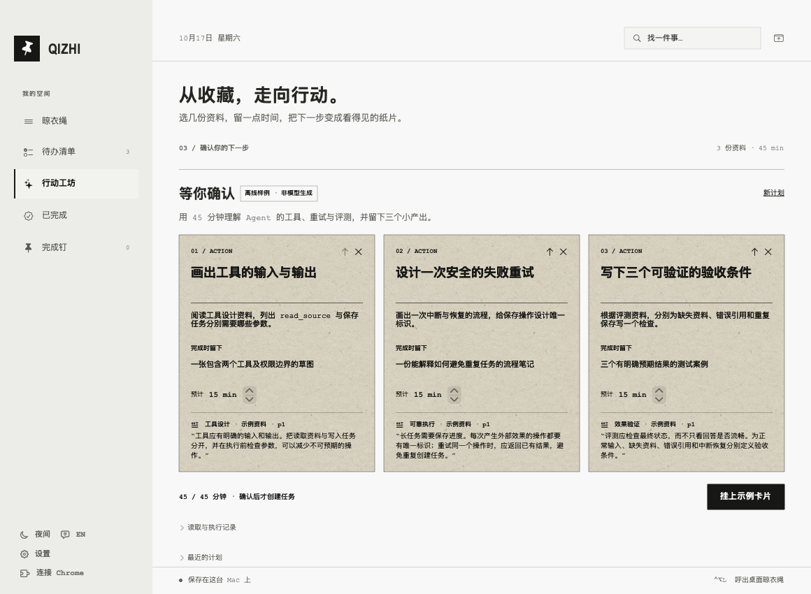
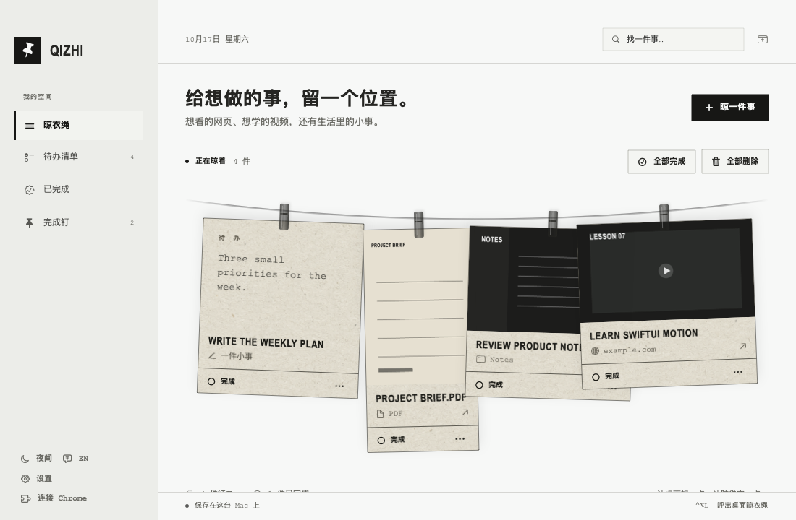
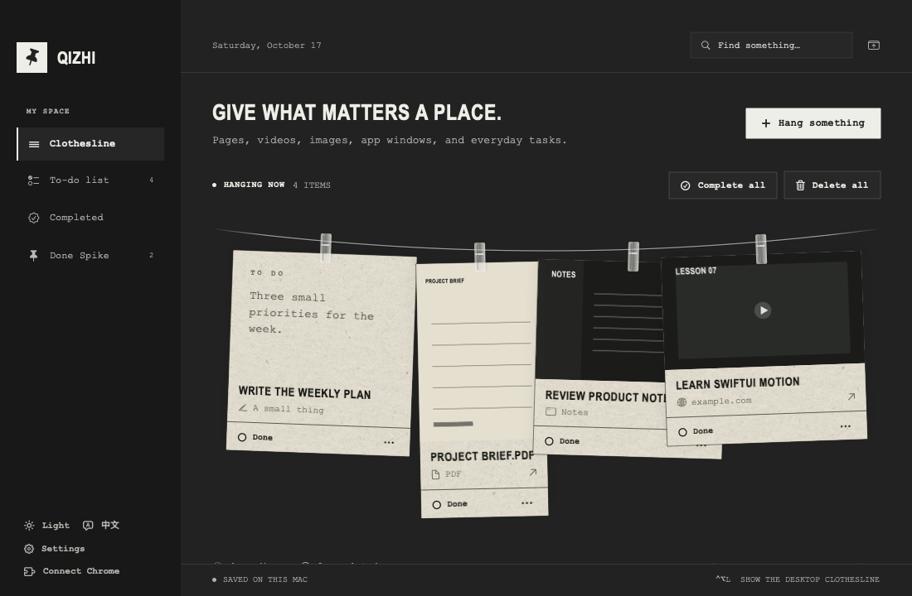

# 栖纸 Qizhi

**把收藏的资料，变成有依据、可确认的下一步。** JY-Luuu 的 macOS 个人衍生版，基于 [Yuxuan Fu 的 Hang Later](https://github.com/yuxuanfuture/hang-later) 的原生纸片界面，新增资料驱动的行动工坊。

原作基线：v0.10.0 / [`dc1b93a`](https://github.com/yuxuanfuture/hang-later/commit/dc1b93abc9a6ab6ff845cfa33df309e43694a9cd)。个人版版本：0.2.0。



## 行动工坊

1. 晾起网页、PDF、Markdown 或文字资料，打开“行动工坊”，选择 1–3 份。
2. 写下目标和 5–120 分钟预算。在“模型连接”中填写兼容接口的完整地址、支持工具调用的模型 ID 和 API Key。
3. 勾选允许把选定正文和目标发给模型，再生成草稿。模型仅能读取选定资料、提交 1–6 张草稿，不能直接修改任务。
4. 点击引用查看原文快照；修改标题、步骤、产出、顺序和时长。点击“确认并挂上”，通过校验后才会一次性创建任务。
5. 取消或失败不会创建任务。重试复用已读取的快照，应用重启后中断的执行可继续。任务保留引用与 PDF 页码，重复确认不会重复创建。

**没有 API Key 也可以“试用离线样例”。** 它使用内置资料和固定结果，不调用模型，不代表真实模型效果，也不会在真实调用失败时自动代替模型。真实功能需要独立 API 额度，聊天订阅不能直接使用。

Key 按接口地址分别存入 macOS 钥匙串。接口需兼容 Chat Completions 的 `tools` / `tool_calls`、`tool_choice: required`、`parallel_tool_calls: false` 和 `max_completion_tokens`；公网接口只允许 HTTPS。不兼容的服务会明确失败。[官方工具调用说明](https://developers.openai.com/api/docs/guides/function-calling)。

读取上限为每份 10 MB，PDF 前 20 页，每份最多 24 段、16,000 字符。网页不执行 JavaScript、不登录，扫描 PDF 尚需先做 OCR。截取长资料会显示提示。引文校验只证明文本存在于快照中，理解和建议仍需人工判断。

产品与技术取舍见 [ACTION_STUDIO.md](docs/ACTION_STUDIO.md)，验证范围见 [ACTION_VALIDATION.md](docs/ACTION_VALIDATION.md)。

<details>
<summary>原生晾衣绳</summary>



</details>

<details>
<summary>深色模式 / Dark mode</summary>



</details>

把网页、图片、PDF、App 窗口、想法和提醒挂在桌面晾衣绳上，点击返回来源，完成后收进归档与可旋转的 3D 完成钉。

## 这个版本做了什么

- 保留原作的暖纸纹理、字体、绳子、夹子、卡片动画、深浅模式和中英文界面。
- 新增行动工坊：受限工具调用、原文引用校验、草稿编辑、检查点恢复，以及防重复批量写入。
- 使用自己的应用标识、存储目录、Chrome 扩展 ID 和 Native Messaging 主机，可与原版分开保存内容。
- 应用程序名和下载附件为 `Qizhi`，系统显示名称为 **栖纸 Qizhi**。
- 增加个人版身份一致性及浏览器消息端到端检查。
- 增加受限构建环境的 SwiftPM 选项，以及 iconutil 不可用时的原图标 ICNS 生成回退。
- 更新 GitHub Actions 到 macOS 15，提供自动检查和应用构建附件。

原始实现和视觉设计来自上游；个人版差异与来源见 [UPSTREAM.md](docs/UPSTREAM.md)。

## 安装与构建

需要 macOS 14 或以上，以及 Swift 6 的 Xcode / Command Line Tools。

```sh
git clone https://github.com/JY-Luuu/qizhi.git
cd qizhi
bash scripts/build-app.sh release
open build/Qizhi.app
```

构建安装包：

```sh
bash scripts/make-dmg.sh
```

结果位于 `build/releases/Qizhi.dmg` 和 `Qizhi.zip`。GitHub Actions 的成功构建会提供应用附件；正式发布版见 [Releases](https://github.com/JY-Luuu/qizhi/releases)。

当前为本地 ad hoc 签名构建，尚未通过 Apple 公证。首次打开时可能需要通过 macOS 的“隐私与安全性”允许启动。屏幕截图、自动化和通知按实际使用申请系统权限。

在禁止 SwiftPM 嵌套沙箱的执行环境中，可以仅为该次构建设置：

```sh
HANG_LATER_DISABLE_SWIFTPM_SANDBOX=1 bash scripts/build-app.sh debug
```

普通开发环境无需设置这个选项。该选项不会更改 macOS 的系统安全设置。

## 连接 Chrome

1. 打开个人版，选择“连接 Chrome”，安装它自己的本地主机。
2. 打开 `chrome://extensions`，开启开发者模式，加载个人版内的 `ChromeExtension` 文件夹。可在连接引导中显示该文件夹。
3. 固定 **栖纸 Qizhi** 扩展，点击保存当前网页，或右键保存链接。

个人版和原版扩展身份不同；请使用与这个应用配套的扩展。扩展使用 Native Messaging，无需本地 HTTP 服务。关闭 App 后，消息可留在 Inbox，下一次打开再导入。

## 数据与隐私

个人版数据保存到：

```text
~/Library/Application Support/Qizhi/
```

不会自动迁移、清空或覆盖原版的 `HangLater/` 数据。任务、截图、资料快照和执行记录保存在本机，没有账号、云同步、统计或遥测。**行动工坊会在你勾选并开始后，把选中的资料正文、标题和目标发送给配置的模型服务商，其 API 计费和数据规则由该服务商决定。** Key 不会写入任务、日志或 GitHub，其他未选中的任务和文件不会交给模型。

添加链接时系统 LinkPresentation 可能请求该网页以取得预览；Chrome 扩展只在主动操作时捕捉内容。原生窗口恢复逻辑在用户触发 Chrome 窗口捕捉或恢复时，可能按精确标题查询本地 Chrome 历史副本，或通过 AppleScript 查找标签页。

## 操作

| 动作 | 结果 |
| --- | --- |
| `⌃⌥L` | 展开或收起桌面晾衣绳 |
| `⌘N` | 选择要添加的内容 |
| 点击纸片 | 打开来源；普通任务进入编辑 |
| 拖动纸片 | 自由放置、重叠，并保存位置 |
| 完成 | 进入归档，符合当前工作日条件时出现在完成钉 |
| 关闭主窗口 | 保留菜单栏运行；从菜单栏退出才结束 |

完成钉按任务的**发布时间**筛选当前工作日。普通 App 窗口可能只能唤起 App，不能恢复其内部光标或滚动位置。同时运行原版时，固定全局快捷键可能发生占用；可以使用菜单栏入口。

## 开发与验证

```sh
bash scripts/swift.sh run HangLaterChecks
bash scripts/swift.sh run QizhiAgentChecks --report /tmp/qizhi-agent-fixtures.json
python3 scripts/verify-agent-http.py
python3 -m unittest discover -s NativeHost -p 'test_*.py' -v
python3 scripts/verify-personal-identity.py
node --check ChromeExtension/popup.js
node --check ChromeExtension/background.js
```

更多检查和安全样例截图入口见 [VERIFICATION.md](docs/VERIFICATION.md)，首版记录见 [BUILD_VALIDATION.md](docs/BUILD_VALIDATION.md)。行动工坊回归检查使用固定替身和本地 HTTP 服务，尚未进行真实用户试用或在线模型质量评测。

## 许可与致谢

MIT。原始项目 Copyright © 2026 Yuxuan Fu；个人版修改 Copyright © 2026 JY-Luuu。保留 [LICENSE](LICENSE) 和 [THIRD_PARTY_NOTICES.md](THIRD_PARTY_NOTICES.md)。部分浮层、绳子和快捷键实现源自 Alejandro Buján 的 Tendedero。

---

## English

栖纸 Qizhi is JY-Luuu's personal derivative of [Hang Later by Yuxuan Fu](https://github.com/yuxuanfuture/hang-later), based on upstream v0.10.0. It preserves the original native macOS interface and workflow while using independent app, storage and Chrome messaging identities. Original authorship and MIT notices are retained. See [UPSTREAM.md](docs/UPSTREAM.md) for provenance and changes.

Version 0.2 adds Action Studio: selected documents → bounded tool calls → evidence-backed drafts → human confirmation → atomic, idempotent task creation. Bring a compatible model endpoint and API key, or try the explicitly labeled deterministic offline sample. Fixture checks are not live-model quality measurements.
